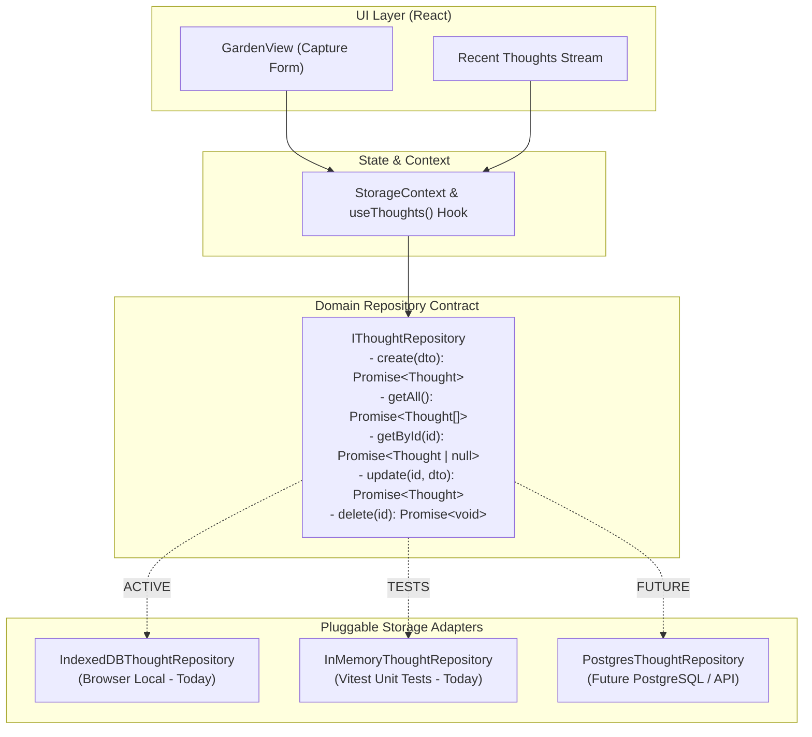

# Implementation Plan: Piece 2 — Pluggable Storage Abstraction & Quick Capture

## Goal Description

Implement the core data persistence and capture flow for **The Thought Garden** with an architecture built specifically for **effortless database migration** (e.g. from browser-local IndexedDB to a future PostgreSQL / REST API backend).

1. **Storage Abstraction Layer (Repository Pattern):** Decouple all UI and business logic from the underlying database using clean interface contracts.
2. **Pluggable Adapters:** Implement `IndexedDBStorageAdapter` for browser-local persistence and `InMemoryStorageAdapter` for lightning-fast unit tests.
3. **Capture Integration:** Connect the "Plant a thought" capture surface to the storage layer, supporting zero-metadata capture, keyboard shortcuts (`Ctrl/Cmd + Enter`), and optimistic visual feedback.
4. **Automated Verification:** Comprehensive Vitest tests verifying repository contracts, empty-input rejection, and data integrity.

---

## User Review Required

> [!IMPORTANT]
> **Database Portability & PostgreSQL Readiness:**
> All UI components, custom hooks, and future search/similarity engines will interact exclusively with the abstract `IThoughtRepository` contract. 
> When migrating to PostgreSQL in the future, only a new `PostgresThoughtRepository` (or `ApiThoughtRepository`) needs to be implemented. The entire UI and application logic will require **zero modifications**.

> [!NOTE]
> **Dependency Addition:**
> We will add [`idb`](https://github.com/jakearchibald/idb) (`^8.0.0`, ~1.1kB gzipped) to `frontend/package.json`. It is the gold-standard typed Promise wrapper for IndexedDB by Jake Archibald, avoiding cumbersome callback ceremony while keeping zero runtime dependencies.

---

## Open Questions

None currently blocking. The initial schema will store:
- `id`: UUID / crypto.randomUUID
- `text`: user's original verbatim thought
- `createdAt`: ISO 8601 string
- `updatedAt`: ISO 8601 string
- `collectionIds`: string[] (empty initially)
- `stage`: GrowthStage ('seed' | 'sprout' | 'bloom' | 'mature')

---

## Architecture Diagram

---

## Proposed Changes

### 1. Storage Abstraction Layer
#### [NEW] `frontend/src/storage/types.ts`
* DTOs: `CreateThoughtDTO`, `UpdateThoughtDTO`
* Abstract interfaces: `IThoughtRepository`, `IStorageService`
* Provider configuration type: `'indexeddb' | 'memory' | 'postgres'`

#### [NEW] `frontend/src/storage/memory/InMemoryThoughtRepository.ts`
* Full in-memory implementation of `IThoughtRepository` for rapid unit testing without requiring browser APIs.

#### [NEW] `frontend/src/storage/indexeddb/database.ts`
* IndexedDB database initialization, object stores (`thoughts`, `collections`, `connections`), and schema versioning via `idb`.

#### [NEW] `frontend/src/storage/indexeddb/IndexedDBThoughtRepository.ts`
* Concrete implementation of `IThoughtRepository` querying IndexedDB.

#### [NEW] `frontend/src/storage/index.ts`
* Storage factory `getThoughtRepository()` providing the configured adapter based on environment.

---

### 2. State & Context Layer
#### [NEW] `frontend/src/context/StorageContext.tsx`
* Provides reactive state (`thoughts`, `isLoading`, `createThought`, `deleteThought`, `refreshThoughts`).
* Exposes clean hook: `useThoughts()`.

---

### 3. UI Capture Wiring
#### [MODIFY] `frontend/src/views/GardenView.tsx`
* Wire textarea state to `createThought()`.
* Add `Ctrl/Cmd + Enter` hotkey handler.
* Add momentary gentle "Planted 🌱" feedback badge.
* Render recently captured thoughts list directly below the capture surface, dynamically replacing the first-run empty state once thoughts exist.

#### [MODIFY] `frontend/src/App.tsx`
* Wrap application tree in `<StorageProvider>`.

---

### 4. Manifest & Dependency Updates
#### [MODIFY] `frontend/package.json`
* Add `idb: ^8.0.0` to dependencies.

#### [MODIFY] `requirements.txt`
* Document `idb@8.0.0` with purpose and versioning.

---

### 5. Automated Tests
#### [NEW] `frontend/src/storage/storage.test.ts`
* Comprehensive test suite verifying:
  1. Creation of thoughts without metadata.
  2. Prevention of empty or whitespace-only thought creation.
  3. Reverse chronological sorting (`createdAt` desc).
  4. Deletion and retrieval by ID.
  5. Verifying that `IndexedDB` and `InMemory` adapters produce identical contract outputs.

---

## Verification Plan

### Automated Tests
* Run `npm test` inside `frontend/` to execute all storage unit tests.
* Run `npm run build` inside `frontend/` to verify zero TypeScript errors.

### Manual Verification
1. Open [http://localhost:5173](http://localhost:5173).
2. Enter a thought in the capture field: "Ideas about local-first software architecture".
3. Press `Ctrl + Enter` (or click "Plant thought").
4. Verify the input clears and the thought card appears immediately in the stream.
5. Refresh the browser page (`F5`) and verify the saved thought is still present.
6. Open browser DevTools -> Application -> IndexedDB -> `ThoughtGardenDB` -> `thoughts` store to inspect the persisted record.
