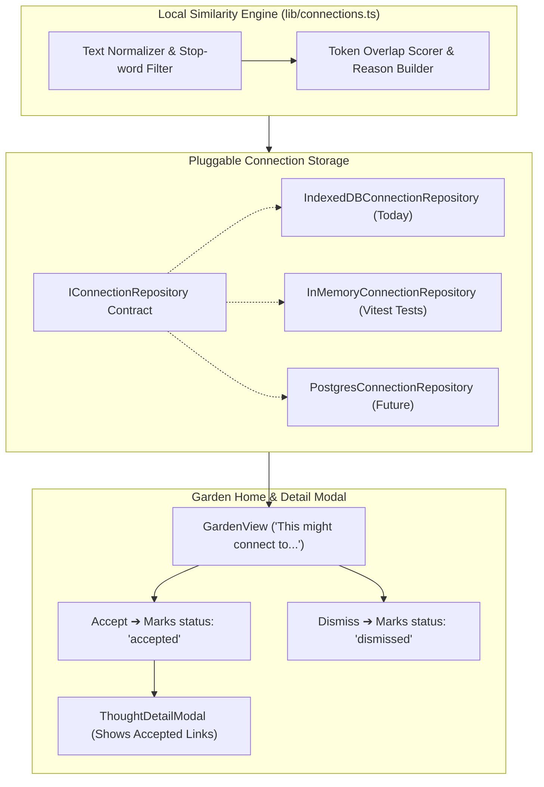

# Implementation Plan: Piece 5 — Local Explainable Connection Discovery Engine

## Goal Description

Implement the **Connection Discovery Engine** for **The Thought Garden**:
1. **Zero-API Local Similarity Engine:** A transparent, client-side algorithm using normalized token overlap and English stop-word removal. Zero data sent to any network or third-party service.
2. **Transparent, Grounded Explanations:** Clear explanations derived from actual shared words (e.g., *"Both thoughts mention architecture and systems"*). No claims of "deep AI understanding".
3. **Pluggable Connection Repository (`IConnectionRepository`):** Fully abstracted repository pattern supporting IndexedDB and In-Memory storage (ready for future PostgreSQL migration).
4. **Interactive Suggestion Card on Garden Home:** Displays *"This might connect to…"* with side-by-side thought previews, explainable reason, and one-click **Accept** or **Dismiss**.
5. **Reversibility & Dismissal Memory:** Dismissed suggestions are recorded so they never nag the user again; accepted connections appear on the Thought Detail Modal.

---

## User Review Required

> [!IMPORTANT]
> **Conservative Similarity Threshold:**
> Per `MVP_SPEC.md`, connection quality is prioritized over quantity. If no thoughts share at least 2 distinct meaningful keywords (above minimum token length and excluding stop-words), **no suggestion is shown** rather than surfacing noisy or weak associations.

> [!NOTE]
> **Strict Pairing Integrity:**
> - Self-connections (Thought A connecting to Thought A) are strictly excluded.
> - Symmetric pairs are treated as unordered: `(A, B)` is identical to `(B, A)` so duplicate links never appear.

---

## Open Questions

None currently blocking. Accepted connections will be displayed directly inside the Thought Detail Modal under "Connected Thoughts".

---

## Architecture Diagram

---

## Proposed Changes

### 1. Storage Abstraction Layer (Repository Pattern)
#### [MODIFY] `frontend/src/storage/types.ts`
* Add `CreateConnectionDTO`, `UpdateConnectionDTO`.
* Define `IConnectionRepository` interface:
  - `create(dto: CreateConnectionDTO): Promise<Connection>`
  - `getById(id: string): Promise<Connection | null>`
  - `getAll(): Promise<Connection[]>`
  - `getByStatus(status: ConnectionStatus): Promise<Connection[]>`
  - `update(id: string, dto: UpdateConnectionDTO): Promise<Connection>`
  - `delete(id: string): Promise<void>`
  - `findPair(sourceId: string, targetId: string): Promise<Connection | null>`

#### [NEW] `frontend/src/storage/memory/InMemoryConnectionRepository.ts`
* In-memory implementation of `IConnectionRepository` for fast Vitest automated tests.

#### [NEW] `frontend/src/storage/indexeddb/IndexedDBConnectionRepository.ts`
* Production IndexedDB implementation backed by the existing `connections` store in `ThoughtGardenDB`.

#### [MODIFY] `frontend/src/storage/index.ts`
* Add `getConnectionRepository()` and `setConnectionRepository()` factories.

---

### 2. Local Similarity & Explanation Algorithm
#### [NEW] `frontend/src/lib/connections.ts`
* Comprehensive English stop-word list (~120 common functional words).
* `extractMeaningfulTokens(text: string): string[]`: removes stop-words and short tokens (< 3 chars).
* `generateConnectionSuggestions(thoughts, existingConnections)`:
  - Scans all pairs of thoughts `(A, B)`.
  - Excludes self-links and already accepted or dismissed pairs.
  - Computes shared meaningful words.
  - Produces plain-language explanation: *"Both thoughts mention [term1] and [term2]"*.
  - Returns top ranked candidate suggestion.

---

### 3. State & Context Layer
#### [MODIFY] `frontend/src/context/StorageContext.tsx`
* Provide reactive connection actions:
  - `connections: Connection[]`
  - `suggestedConnection: SuggestedConnection | null`
  - `acceptConnection(sourceId: string, targetId: string, reason: string): Promise<void>`
  - `dismissConnection(sourceId: string, targetId: string): Promise<void>`

---

### 4. UI Components & Views
#### [MODIFY] `frontend/src/views/GardenView.tsx`
* Add the **"This might connect to…"** suggestion card above recent thoughts:
  - Displays preview of Thought A and Thought B.
  - Explanatory reason with highlighted common words.
  - One-click **Accept** button (creates permanent connection).
  - One-click **Dismiss** button (permanently records dismissal).
#### [MODIFY] `frontend/src/components/ThoughtDetailModal.tsx`
* Add "Connected Thoughts" section showing accepted links for the open thought.

---

### 5. Automated Tests
#### [NEW] `frontend/src/storage/connections.test.ts`
* Vitest test suite verifying:
  1. Stop-word filtering and token overlap scoring.
  2. Conservative threshold enforcement.
  3. Plain-language explanation generation.
  4. Dismissal memory (dismissed pairs are never suggested again).
  5. Acceptance persistence (accepted connections appear on both thoughts).
  6. Self-link and duplicate pair prevention.

---

## Verification Plan

### Automated Tests
* Run `npm test` inside `frontend/` to execute all connection algorithm and repository tests.
* Run `npm run build` inside `frontend/` to verify zero TypeScript errors.

### Manual Verification
1. Open [http://localhost:5173](http://localhost:5173).
2. Plant thought 1: *"Urban gardening requires living soil and compost."*
3. Plant thought 2: *"Good compost improves the health of community gardening projects."*
4. Confirm the **"This might connect to…"** card appears on the Garden home page:
   - Reason: *"Both thoughts mention gardening and compost."*
5. Click **Accept**; verify it saves and the suggestion card clears.
6. Click thought 1 to open the Detail Modal and verify thought 2 appears under **Connected Thoughts**.
7. Plant another pair of related thoughts, click **Dismiss**, and verify the suggestion never appears again.
