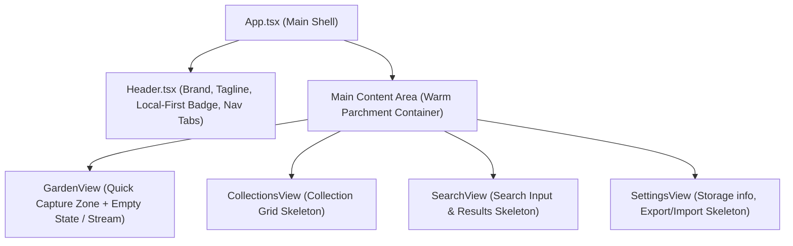

# Implementation Plan: Piece 1 — Foundation, Botanical Design System & App Shell

## Goal Description

Establish the foundation for **The Thought Garden**:
1. Initialize a clean, modern, zero-dependency-bloat frontend project using **React, Vite, TypeScript, and Tailwind CSS**.
2. Encode the botanical visual language outlined in `Docs/thought-garden-starter/docs/UX_AND_VISUAL_DIRECTION.md` and the visual references (`how-the-collection-looks-ui.jpg`, `App-flow'.png`, and `4XmOrQjwPUHmLdGUp9rNOLhY3A seed.jpg`).
3. Create the responsive App Shell with top navigation, view switching (`Garden`, `Collections`, `Search`, `Settings`), botanical empty states, and local storage transparency notices.

By the end of Piece 1, you will have a live, beautifully styled application running locally, ready to receive the capture and persistence logic in Piece 2.

---

## User Review Required

> [!IMPORTANT]
> **Styling & Tooling Choice:**
> We will configure **Tailwind CSS v3** with custom theme color tokens reflecting the calm botanical palette (`parchment`, `sage`, `moss`, `clay`, `earth`, `stone`). This avoids heavyweight component libraries (MUI/Chakra/AntD) and keeps the UI lightweight, custom, accessible, and fast.

> [!NOTE]
> **Local-First Notice:**
> Per `MVP_SPEC.md` and `AGENTS.md`, the app will display a gentle, non-intrusive indicator in the header: *"Saved locally in this browser"*, setting user expectations right from the start.

---

## Open Questions

None currently blocking. If you have specific preferences regarding font pairing (e.g., system serif for headings vs pure sans-serif), we will default to an elegant editorial serif for titles and a legible sans-serif for UI copy.

---

## Architecture & Layout Overview

---

## Proposed Changes

### 1. Build & Tooling Setup
#### [NEW] `package.json`
* Dependencies: `react`, `react-dom`, `lucide-react`, `clsx`, `tailwind-merge`
* Dev dependencies: `vite`, `@vitejs/plugin-react`, `typescript`, `tailwindcss`, `postcss`, `autoprefixer`

#### [NEW] `vite.config.ts`
* Vite React plugin configuration.

#### [NEW] `tsconfig.json`, `tsconfig.node.json`
* TypeScript configuration with strict mode and path aliasing if needed.

#### [NEW] `tailwind.config.js` & `postcss.config.js`
* Custom color palette:
  - `garden-bg`: `#FAF7F2` (warm parchment)
  - `garden-surface`: `#FFFFFF` (card white)
  - `garden-border`: `#EBE3D7` (soft earthy outline)
  - `garden-sage`: `#587B64` (muted primary botanical green)
  - `garden-sage-light`: `#EDF3EE` (soft green tint for badges/buttons)
  - `garden-moss`: `#829676` (leaf accent)
  - `garden-clay`: `#BD7755` (warm seed/terracotta accent)
  - `garden-earth`: `#2D2926` (high contrast readable text)
  - `garden-stone`: `#736B63` (secondary muted text)

---

### 2. Styling Foundation & Global Tokens
#### [NEW] `src/index.css`
* Tailwind directives and CSS variables.
* Custom scrollbars, focus ring accessibility defaults, and warm backdrop styling.

---

### 3. Core Shell Components
#### [NEW] `src/components/Header.tsx`
* Top navigation bar with:
  - Botanical logo mark (sprout icon)
  - "The Thought Garden" title & tagline ("Every thought has a home")
  - Nav tabs: **Garden**, **Collections**, **Search**, **Settings**
  - Subtle status pill: *"Data stored locally in browser"*

#### [NEW] `src/components/Navigation.tsx`
* Accessible tab switcher with active states, keyboard focus, and gentle indicator styling.

#### [NEW] `src/views/GardenView.tsx`
* The primary home view:
  - Capture field container (ready for Piece 2 input wiring)
  - Welcoming empty state card: *"Your garden starts with one thought"* with botanical sprout visual
  - Privacy & persistence notice banner

#### [NEW] `src/views/CollectionsView.tsx`
* Placeholder view mirroring `how-the-collection-looks-ui.jpg` layout with category filters and preview card skeleton.

#### [NEW] `src/views/SearchView.tsx`
* Placeholder view for search.

#### [NEW] `src/views/SettingsView.tsx`
* Placeholder view detailing browser IndexedDB storage and upcoming export/import.

#### [NEW] `src/App.tsx`
* Main application combining `Header` and the active view with smooth state-based routing.

#### [NEW] `src/main.tsx` & `index.html`
* Application mount and HTML title/meta setup.

---

## Verification Plan

### Automated Tests / Build Checks
* Run `npm install` and verify dependency installation.
* Run `npx tsc --noEmit` to verify zero TypeScript errors.
* Run `npm run build` to verify clean Vite production bundle compilation.

### Manual Verification
1. Launch dev server (`npm run dev`) and open the local URL in browser.
2. Confirm the visual aesthetics match the botanical warmth in `Docs/Visual_Feel_References/`.
3. Switch between tabs (`Garden`, `Collections`, `Search`, `Settings`) and ensure smooth transitions.
4. Verify responsiveness at desktop and mobile viewport widths.
5. Check keyboard navigation (Tab, Enter) and focus rings for accessibility.
