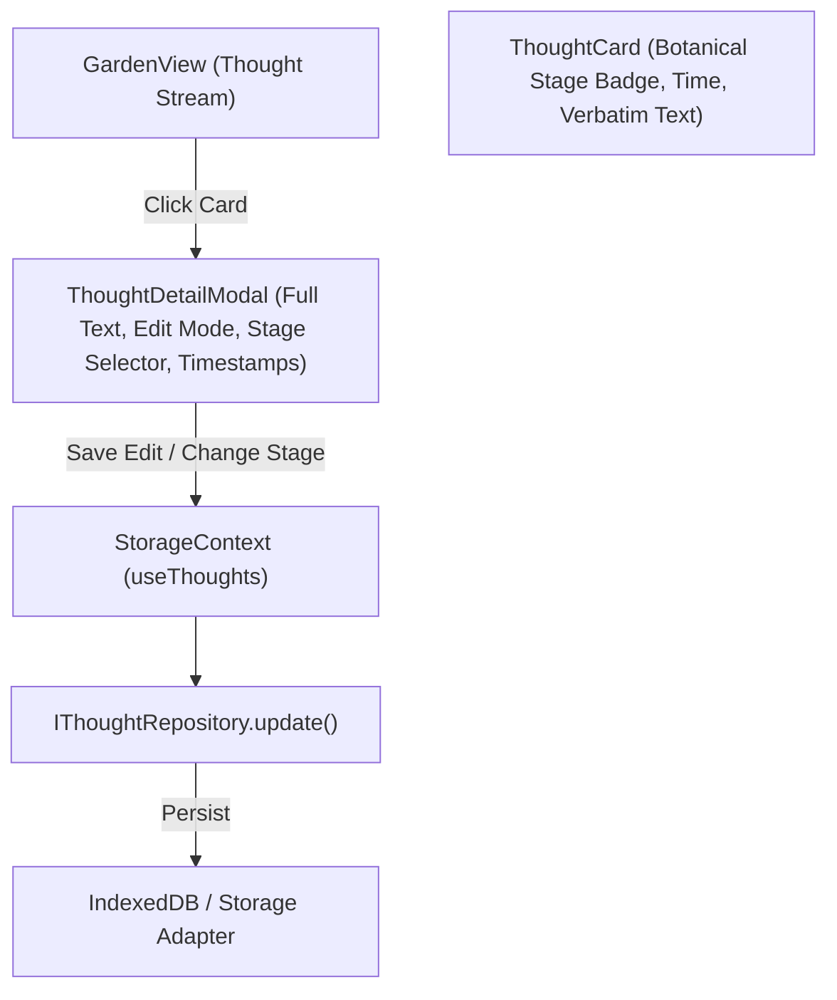

# Implementation Plan: Piece 3 — Thought Stream, Botanical Growth Stages & Detail Editing

## Goal Description

Enhance the thought experience in **The Thought Garden** by enabling thoughtful inspection, editing, and growth tracking:
1. **Botanical Growth Stages:** Introduce meaningful growth progression stages (`Seed 🌱` → `Sprout 🌿` → `Bloom 🌸` → `Mature ✨`) matching `docs/Visual_Feel_References/how-the-collection-looks-ui.jpg`.
2. **Thought Detail & Editing Modal:** An accessible, quiet detail view allowing users to inspect full thought text, edit their words verbatim, view precise creation and last-tended timestamps, and adjust growth stages.
3. **Safe Deletion:** Add confirmation to prevent accidental loss of thoughts.
4. **Storage Layer Enrichment:** Expose `updateThought(id, updates)` in `StorageContext` and ensure both IndexedDB and In-Memory repositories persist updates faithfully.

---

## User Review Required

> [!IMPORTANT]
> **User Agency Over Growth Stages:**
> Per product principles in `PRODUCT_BRIEF.md` (*"Never silently rewrite, merge, or delete"* and *"Unfinished is a valid state"*), growth stages are **never forced**. A thought may remain a `Seed` indefinitely without guilt or expiration. Users can change the stage at any time via a gentle stage selector in the detail view.

> [!NOTE]
> **Timestamp Integrity:**
> When a thought is edited, `createdAt` remains unchanged (preserving the moment of inspiration), while `updatedAt` is refreshed (showing when the thought was last tended).

---

## Open Questions

None currently blocking. We will default to a calm, focused center modal with soft backdrop blur and keyboard dismissal (<kbd>Escape</kbd> to close).

---

## Architecture & Layout Overview

---

## Proposed Changes

### 1. Storage & Domain Layer
#### [MODIFY] `frontend/src/context/StorageContext.tsx`
* Add `updateThought(id: string, updates: { text?: string; stage?: GrowthStage }): Promise<Thought>` to context value.

---

### 2. UI Components
#### [NEW] `frontend/src/components/GrowthStageBadge.tsx`
* Visual badge component with stage-specific botanical colors and icons:
  - `Seed` (Clay/warm amber, Sprout icon)
  - `Sprout` (Sage/leaf green, Leaf icon)
  - `Bloom` (Rose/soft pink, Flower2 icon)
  - `Mature` (Ochre/golden sparkle, Sparkles icon)

#### [NEW] `frontend/src/components/ThoughtDetailModal.tsx`
* Full inspection modal featuring:
  - Verbatim text reading mode & editable textarea mode
  - Growth stage picker (<kbd>Seed</kbd>, <kbd>Sprout</kbd>, <kbd>Bloom</kbd>, <kbd>Mature</kbd>)
  - Timestamp display ("Planted on Oct 10, 2026, 7:00 AM • Last tended Oct 10, 2026, 7:15 AM")
  - Safe delete button with confirm popover/state
  - Keyboard accessible (<kbd>Escape</kbd> to close, <kbd>Ctrl+Enter</kbd> to save changes)

#### [MODIFY] `frontend/src/views/GardenView.tsx`
* Replace inline card rendering with clickable card components.
* Clicking any card opens `ThoughtDetailModal`.
* Add quick stage badge on each card.

---

### 3. Automated Tests
#### [MODIFY] `frontend/src/storage/storage.test.ts`
* Add tests verifying:
  - Stage update persistence across repositories.
  - Timestamp integrity (`createdAt` unchanged, `updatedAt` renewed upon edit).
  - Validation that invalid/empty text edits are rejected.

---

## Verification Plan

### Automated Tests
* Run `npm test` inside `frontend/` to ensure all repository and stage update tests pass.
* Run `npm run build` inside `frontend/` to verify zero TypeScript errors.

### Manual Verification
1. Open [http://localhost:5173](http://localhost:5173).
2. Plant a new thought ("Reflections on biological systems in software").
3. Click the newly planted card to open the Detail Modal.
4. Change its stage from `Seed` to `Sprout` or `Bloom`.
5. Edit the text to add a second sentence and click "Save changes" (or press <kbd>Ctrl+Enter</kbd>).
6. Refresh the page (<kbd>F5</kbd>) and verify the updated text, refreshed timestamp, and new stage badge are preserved in IndexedDB.
7. Open the modal again and test the delete button with confirmation.
