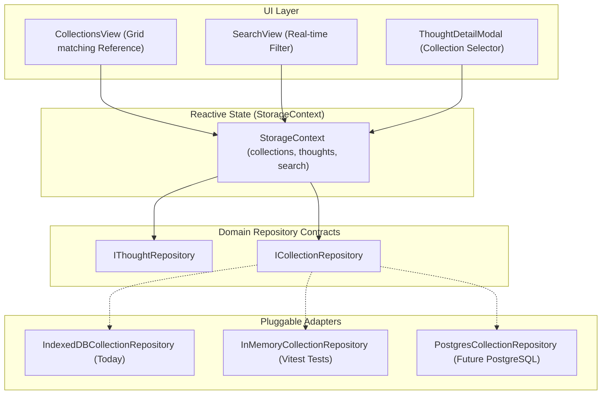

# Implementation Plan: Piece 4 — Collections & Real-time Search

## Goal Description

Implement **Collections** and **Local Real-time Search** in **The Thought Garden**:
1. **Pluggable Collection Storage (`ICollectionRepository`):** Follow the established Repository Pattern to guarantee effortless future migration from IndexedDB to PostgreSQL for collections data.
2. **Collection Organization:** Users can create, rename, and delete collections, and add or remove thoughts to/from collections without altering original thought text.
3. **"My Collection" Visual Grid View:** Transform `frontend/src/views/CollectionsView.tsx` to match the visual reference `docs/Visual_Feel_References/how-the-collection-looks-ui.jpg`, displaying live user collections, member thoughts, and growth stages.
4. **Local Search Engine:** Normalized, case-insensitive, punctuation-tolerant search in `frontend/src/views/SearchView.tsx` searching across thought text and collection titles with clear zero-result empty states.

---

## User Review Required

> [!IMPORTANT]
> **Data Integrity Rule: Deleting a Collection Never Deletes Thoughts:**
> Per `MVP_SPEC.md` and `TECHNICAL_PLAN.md`, collections are lightweight lenses. If a user deletes a collection, all member thoughts remain completely safe in the garden with their `collectionIds` cleanly unlinked.

> [!NOTE]
> **Flexible Thought Membership:**
> A thought can belong to zero, one, or multiple collections. In the Thought Detail Modal, users will be able to check/uncheck collection tags with instantaneous persistence.

---

## Open Questions

None currently blocking. Search will operate 100% locally in the browser with normalized substring and token matching.

---

## Architecture & Layout Overview

---

## Proposed Changes

### 1. Storage Abstraction Layer (Repository Pattern)
#### [MODIFY] `frontend/src/storage/types.ts`
* Add `CreateCollectionDTO`, `UpdateCollectionDTO`.
* Define `ICollectionRepository` interface:
  - `create(dto: CreateCollectionDTO): Promise<Collection>`
  - `getById(id: string): Promise<Collection | null>`
  - `getAll(): Promise<Collection[]>`
  - `update(id: string, dto: UpdateCollectionDTO): Promise<Collection>`
  - `delete(id: string): Promise<void>`
  - `count(): Promise<number>`

#### [NEW] `frontend/src/storage/memory/InMemoryCollectionRepository.ts`
* In-memory implementation of `ICollectionRepository` for fast Vitest automated tests.

#### [NEW] `frontend/src/storage/indexeddb/IndexedDBCollectionRepository.ts`
* Production IndexedDB implementation backed by the existing `collections` store in `ThoughtGardenDB`.

#### [MODIFY] `frontend/src/storage/index.ts`
* Add `getCollectionRepository()` factory supporting provider switching.

---

### 2. State & Context Layer
#### [MODIFY] `frontend/src/context/StorageContext.tsx`
* Provide reactive collections state:
  - `collections: Collection[]`
  - `createCollection(name: string, description?: string): Promise<Collection>`
  - `updateCollection(id: string, updates: { name?: string; description?: string }): Promise<Collection>`
  - `deleteCollection(id: string): Promise<void>` (also safely unlinking `collectionIds` from existing thoughts)
  - `toggleThoughtCollection(thoughtId: string, collectionId: string): Promise<void>`

---

### 3. Search Utility
#### [NEW] `frontend/src/lib/search.ts`
* Local normalized search function:
  - Strips punctuation, trims whitespace, and normalizes accents/casing.
  - Returns matching thoughts and matching collections with highlighted term ranges.

---

### 4. UI Components & Views
#### [MODIFY] `frontend/src/components/ThoughtDetailModal.tsx`
* Add interactive "Collections" tagging section allowing users to add/remove the thought from any collection.

#### [MODIFY] `frontend/src/views/CollectionsView.tsx`
* Replace mock data with live collections from `useThoughts()`.
* Add "New Collection" modal dialog ("Plant a collection").
* Clicking a collection filters/displays its member thoughts in a gentle sub-view or expandable card drawer.
* Delete/rename collection controls with confirmation.

#### [MODIFY] `frontend/src/views/SearchView.tsx`
* Wire search input to local search engine across thoughts and collections.
* Show live matching cards with click-to-inspect opening the Thought Detail Modal.
* Friendly empty states for initial search vs no results.

---

### 5. Automated Tests
#### [NEW] `frontend/src/storage/collections.test.ts`
* Test suite verifying:
  1. Creation of collections with duplicate name prevention/handling.
  2. Safe deletion: deleting a collection does NOT delete member thoughts, only unlinks IDs.
  3. Thought assignment & un-assignment.
  4. Local search normalization and token matching accuracy.

---

## Verification Plan

### Automated Tests
* Run `npm test` inside `frontend/` to execute all collection and search unit tests.
* Run `npm run build` inside `frontend/` to verify zero TypeScript errors.

### Manual Verification
1. Open [http://localhost:5173](http://localhost:5173).
2. Go to **Collections** tab and click **New Collection** (e.g. "Work Ideas").
3. Go back to **Garden**, open a thought, and assign it to "Work Ideas".
4. Return to **Collections**, open "Work Ideas", and confirm the assigned thought is displayed.
5. Go to **Search** tab, type a partial word from the thought or collection name, and confirm instantaneous results appear.
6. Delete the collection and verify that the thought still exists safely on the Garden home page.
