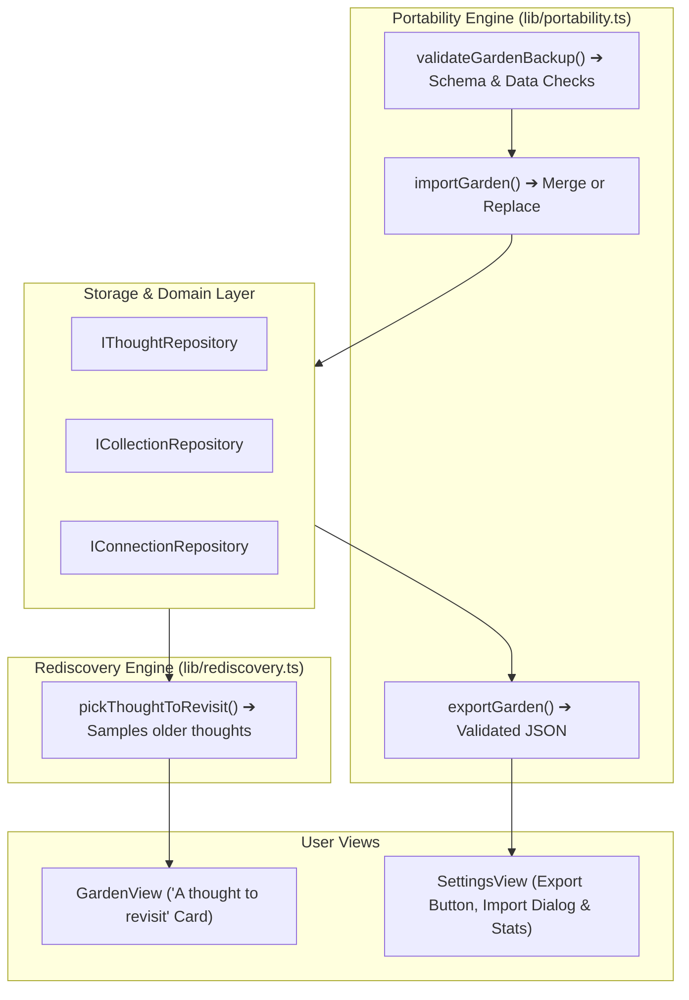

# Implementation Plan: Piece 6 — Gentle Rediscovery & Data Portability

## Goal Description

Deliver the final milestone of **The Thought Garden MVP**:
1. **Gentle Rediscovery ("A thought to revisit"):** Surface an older thought on the Garden home page when enough thoughts exist (>= 3). No guilt, no productivity pressure, and no repetitive nagging. Includes options to inspect or dismiss for now.
2. **Standardized JSON Export:** Export the complete garden (thoughts, collections, and connections) into a versioned, portable JSON file with one click.
3. **Validated JSON Import:** Safely restore garden data with a pre-import inspection dialog, schema validation, non-destructive **Merge** or **Replace** options, and zero-risk rollback on malformed files.
4. **Automated Verification:** Comprehensive round-trip export/import tests, malformed schema rejection tests, and rediscovery algorithm tests.

---

## User Review Required

> [!IMPORTANT]
> **Data Safety During Import:**
> Per `MVP_SPEC.md` and `AGENTS.md`, import will **never silently overwrite existing data**. 
> When importing a backup file, the app presents a modal displaying:
> - Number of thoughts, collections, and connections found.
> - A choice between:
>   - **Merge (Recommended):** Adds backup items alongside current data, preserving both without duplicates.
>   - **Replace Garden:** Overwrites current garden with the backup file (requires explicit confirmation).
> - If the file is malformed, corrupted, or unsupported, existing data remains **100% untouched** and a clear error is shown.

> [!NOTE]
> **Gentle Rediscovery Criteria:**
> The *"A thought to revisit"* card only activates when at least 3 thoughts exist in the garden. It samples from older thoughts and can be dismissed for the session with one click.

---

## Open Questions

None currently blocking. Export file naming convention will be: `thought-garden-backup-YYYY-MM-DD.json`.

---

## Architecture Overview

---

## Proposed Changes

### 1. Portability & Rediscovery Core Libraries
#### [NEW] `frontend/src/lib/portability.ts`
* Defines `GardenBackupV1` interface (`version: 1`, `exportedAt`, `garden: { thoughts, collections, connections }`).
* `exportGardenData(thoughts, collections, connections): string`: Serializes and triggers browser download.
* `validateGardenBackup(jsonString: string): { valid: boolean; data?: GardenBackupV1; error?: string }`:
  - Validates JSON parse.
  - Validates schema version (`version === 1`).
  - Validates thoughts array (checks `id`, non-empty `text`, valid `createdAt`).
  - Validates collections and connections arrays.
* `importGardenData(backup, currentGarden, strategy: 'merge' | 'replace')`: Executes safe merge or replacement.

#### [NEW] `frontend/src/lib/rediscovery.ts`
* `pickThoughtToRevisit(thoughts: Thought[], dismissedIds: Set<string>): Thought | null`:
  - Returns `null` if `thoughts.length < 3`.
  - Excludes session-dismissed thoughts.
  - Samples from older thoughts (e.g. thoughts older than the 2 most recent).

---

### 2. State & Context Layer
#### [MODIFY] `frontend/src/context/StorageContext.tsx`
* Provide:
  - `exportBackup(): void`
  - `importBackup(jsonString: string, strategy: 'merge' | 'replace'): Promise<{ thoughtsAdded: number; collectionsAdded: number }>`
  - `rediscoveredThought: Thought | null`
  - `dismissRediscoveredThought(id: string): void`

---

### 3. UI Components & Views
#### [MODIFY] `frontend/src/views/GardenView.tsx`
* Add the **"A thought to revisit"** card:
  - Appears below capture when a candidate exists.
  - Card anatomy: gentle history icon, preview text, growth stage badge, and "Planted on [date]".
  - Actions: **Inspect Thought** (opens detail modal) and **Dismiss for now**.
#### [NEW] `frontend/src/components/ImportBackupModal.tsx`
* Modal dialog appearing when user selects a backup JSON file:
  - Displays summary: count of thoughts, collections, and connections.
  - Option to choose **Merge (Recommended)** or **Replace**.
  - Validation error banner if file is invalid.
#### [MODIFY] `frontend/src/views/SettingsView.tsx`
* Wire **Export as JSON** button to `exportBackup()`.
* Wire **Choose Backup File** file input to open `ImportBackupModal`.
* Live storage engine summary.

---

### 4. Automated Tests
#### [NEW] `frontend/src/storage/portability.test.ts`
* Vitest test suite verifying:
  1. Export structure conforms to `GardenBackupV1` schema.
  2. Round-trip integrity: exporting and re-importing preserves all thoughts, collections, connections, and verbatim text.
  3. Rejection of corrupted JSON, invalid schema versions, or missing required fields without modifying storage.
  4. Merge strategy prevents duplicate IDs while preserving existing data.
  5. Rediscovery picker selects from older thoughts and handles small gardens gracefully.

---

## Verification Plan

### Automated Tests
* Run `npm test` inside `frontend/` to execute all portability and rediscovery tests.
* Run `npm run build` inside `frontend/` to verify zero TypeScript errors.

### Manual Verification
1. Open [http://localhost:5173](http://localhost:5173).
2. Go to **Data & Settings** tab and click **Export as JSON**.
3. Verify `thought-garden-backup-YYYY-MM-DD.json` downloads cleanly and contains valid JSON.
4. Add 3 thoughts, refresh, and confirm the **"A thought to revisit"** card appears on the Garden page.
5. Click **Dismiss for now** on the rediscovery card and verify it clears.
6. In **Data & Settings**, test importing the backup file with **Merge**. Confirm data is restored.
7. Test uploading a non-JSON / corrupted file and verify a descriptive error is shown while existing thoughts remain intact.
