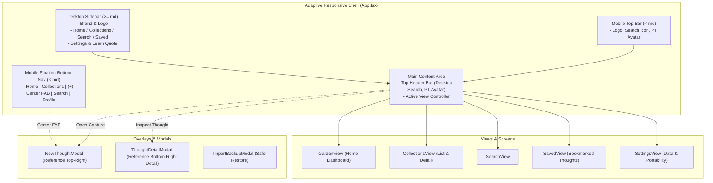

# Implementation Plan: UI/UX Evolution & Full Mobile/Laptop Responsiveness

## Goal Description

Refine and evolve **The Thought Garden** UI/UX to match the exact visual reference in `docs/Visual_Feel_References/App_Each_Page_Design_Reference.png`. 

The application will provide a tailored, delightful experience on both **Laptop/Desktop** (spacious dual-pane layout with persistent botanical sidebar and rich grids) and **Mobile/Phone** (compact, touch-friendly interface with header, mobile cards, botanical footers, and a floating bottom navigation bar featuring a center capture button).

---

## User Review Required

> [!IMPORTANT]
> **Exact Reference Alignment:**
> The design reference contains 6 distinct screen views:
> 1. **Desktop Home Dashboard:** Left sidebar (`Home`, `Collections`, `Search`, `Saved`, `Learn & Explore`), top-right profile badge (`PT`) & search button, personalized greeting (`Good morning, Pragya`), watering can botanical illustration, quick capture box with round dark-green plant button, 4 colored pastel collection cards (`Startup Ideas`, `Writing`, `Things to Research`, `Tasks to Revisit`), and a categorized recent thoughts feed.
> 2. **"New Thought" Dedicated Screen/Modal:** Clean card input with `0/1000` counter, circular plant button, and the leaf illustration with *"Just plant the thought. The garden will take care of the rest."*
> 3. **Collections Overview:** Header with search, rounded list cards for collections with counts and arrow indicators, plus a `+ New Collection` button.
> 4. **Collection Detail View:** Header with back navigation, subtitle with thought count and description, and categorized thought cards.
> 5. **Thought & Connection Detail View:** Prominent thought typography, `🔗 Connection` pill badge, timestamp with pin tag, "Related Thoughts" card list, and "A possible connection" callout card.
> 6. **Mobile Phone Experience:** Sticky mobile top bar, responsive capture, compact collection rows, botanical hill footer, and bottom navigation bar with an elevated center `+` action button.

> [!NOTE]
> **Default Starter Collections:**
> If a user starts with an empty garden or resets their data, the app will auto-seed the 4 default collections from the design reference (`Startup Ideas`, `Writing`, `Things to Research`, `Tasks to Revisit`) so the garden immediately matches the visual reference while remaining 100% editable and customizable.

---

## Architecture & Layout System

---

## Proposed Changes

### 1. Types & Helpers

#### [MODIFY] `frontend/src/types/index.ts`
- Extend `NavTab`: `'garden' | 'collections' | 'search' | 'saved' | 'settings'`.
- Add optional metadata to `Thought`: `isSaved?: boolean; category?: 'idea' | 'research' | 'writing' | 'task' | 'connection' | 'thought'`.
- Add optional styling metadata to `Collection`: `colorVariant?: 'green' | 'rose' | 'purple' | 'amber'; iconType?: string`.

#### [NEW] `frontend/src/lib/time.ts`
- `formatRelativeTime(isoString: string): string`: Returns compact relative strings matching the reference: `"Just now"`, `"2h ago"`, `"4h ago"`, `"1d ago"`, `"3d ago"`.

#### [NEW] `frontend/src/lib/defaults.ts`
- Defines the 4 starter collections matching the reference:
  1. **Startup Ideas** (green variant, sprout icon, *"Ideas, products and business opportunities."*)
  2. **Writing** (rose variant, pencil icon, *"Blog ideas, drafts, quotes and more."*)
  3. **Things to Research** (purple variant, search icon, *"Questions, topics and areas to explore."*)
  4. **Tasks to Revisit** (amber variant, check icon, *"Reminders, follow-ups and action items."*)

---

### 2. Botanical Vector Art & Illustrations

#### [NEW] `frontend/src/components/BotanicalIllustrations.tsx`
- Pure, clean SVG botanical components matching the design reference:
  - `WateringCanHeroArt`: Pastel sage watering can with gentle water drops sprinkling growing leaves on a soft grassy mound (for desktop & tablet greeting banner).
  - `SproutLeafClusterArt`: Centered leaf cluster with organic branch curves for the "Just plant the thought" modal section.
  - `RollingHillsFooterArt`: Soft undulating pastel hill contours for the mobile bottom background.

---

### 3. Shell & Responsive Layout

#### [NEW] `frontend/src/components/Sidebar.tsx`
- Persistent left sidebar for laptop/desktop (`hidden md:flex flex-col w-64 bg-[#f8f6f0] border-r border-[#ebe7dd]`):
  - Brand header: Sprout icon + "The Thought Garden".
  - Nav items with rounded active pill styles:
    - **Home** (`Home` icon)
    - **Collections** (`Library` / folder icon)
    - **Search** (`Search` icon)
    - **Saved** (`Bookmark` icon)
    - **Data & Settings** (`SlidersHorizontal` / settings icon)
  - Sub-link: `Learn & Explore >` (with informational guide tooltip / modal).
  - Bottom card: Small seedling icon + *"Small thoughts can grow into big things."*

#### [NEW] `frontend/src/components/TopHeader.tsx`
- **On Desktop:** Subtly positioned at top right of main content with search quick button and `PT` avatar badge (Pragya Tripathi) showing user profile info.
- **On Mobile:** Fixed top bar with logo, search icon, and `PT` avatar badge.

#### [NEW] `frontend/src/components/MobileBottomNav.tsx`
- Bottom navigation bar visible only on `< md` screens:
  - Docked at bottom with blur and subtle border.
  - 5 slots: **Home**, **Collections**, **Center `+` FAB**, **Search**, **Profile/Settings**.
  - The center FAB is an elevated dark green circle (`bg-[#2d4a34]`) with a white `+` icon that triggers the dedicated `NewThoughtModal`.

#### [MODIFY] `frontend/src/App.tsx`
- Replace single top-header layout with responsive dual-mode layout:
  - Desktop: Persistent `Sidebar` + Main content area with `TopHeader`.
  - Mobile: `TopHeader` (mobile mode) + Main content + `MobileBottomNav`.
  - Add state for `isNewThoughtModalOpen` (accessible globally from header, mobile FAB, or keyboard shortcut).

---

### 4. Modals & Detail Views

#### [NEW] `frontend/src/components/NewThoughtModal.tsx`
- Exactly reproduces the top-right screen in the reference:
  - Header: `<- New Thought` on left, `X` close on right.
  - Card container:
    - Label: "What's on your mind?"
    - Textarea with placeholder: *"e.g. Startup idea: an app that helps people stop forgetting their ideas..."*
    - Character counter: `0/1000`.
    - Circular dark-green submit button with seedling/arrow glyph.
  - Bottom illustration section:
    - `SproutLeafClusterArt`.
    - Caption: *"Just plant the thought. The garden will take care of the rest."*

#### [MODIFY] `frontend/src/components/ThoughtDetailModal.tsx`
- Refine layout to match the reference's Thought & Connection Detail screen:
  - Top header with back button and `...` options menu (delete, bookmark/save, change growth stage).
  - `🔗 Connection` badge when connected or selected from connections.
  - Prominent headline typography for the thought text.
  - Timestamp with pin tag (`2h ago • 📌`).
  - **Related Thoughts** section with cards for connected thoughts.
  - **"A possible connection"** callout card explaining why thoughts connect.
  - Bookmark / Save toggle button.

---

### 5. Main Views Refinement

#### [MODIFY] `frontend/src/views/GardenView.tsx`
- Refactor the Home screen to match top-left (desktop) and bottom-right (mobile):
  - **Greeting Banner:**
    - Seedling icon + "Good morning, Pragya" (personalized to current time of day).
    - Subtitle: "Your thoughts are growing."
    - `WateringCanHeroArt` SVG illustration on the right side.
  - **Quick Capture Card:**
    - "What's on your mind?" with placeholder.
    - Bottom-right circular dark-green plant button.
  - **"Your Collections" Row:**
    - Header: "Your Collections" with "View all" link.
    - Desktop: 4 pastel cards in a grid:
      1. *Startup Ideas* (soft green, sprout icon, count, description, arrow `→`)
      2. *Writing* (soft blush/rose, pencil icon, count, description, arrow `→`)
      3. *Things to Research* (soft lavender, search icon, count, description, arrow `→`)
      4. *Tasks to Revisit* (soft amber, check icon, count, description, arrow `→`)
    - Mobile: Compact rounded list rows with icon, name, count, and chevron `>`.
    - Clicking any collection navigates directly into the collection detail screen!
  - **"Recent Thoughts" Section:**
    - Header: "Recent Thoughts" with "View all" link.
    - Row-based list matching reference:
      - Category circle icon (💡 Idea, 🔍 Research, ✏️ Writing, 📋 Task, 🔗 Connection).
      - Thought text.
      - Relative timestamp on right (`2h ago`, `4h ago`, etc.).
      - Category pill badge (`Connections`, `Research`, `Writing`, `Tasks`, `Idea`).
  - Seamlessly integrates existing discovery cards ("This might connect to…", "A thought to revisit") with matching botanical aesthetics.

#### [MODIFY] `frontend/src/views/CollectionsView.tsx`
- Match bottom-left screen:
  - Header: `<- Collections` with search button.
  - List of collection cards with icon, count, description, and chevron `>`.
  - `+ New Collection` button at bottom.
  - Drill-down into collection detail view matching bottom middle-left screen (`<- Startup Ideas`, thought count and description subtitle, categorized thought cards).

#### [NEW] `frontend/src/views/SavedView.tsx`
- Dedicated view for the `Saved` tab in the sidebar.
- Displays all thoughts that have been bookmarked/saved by the user.

---

### 6. Storage & Context Layer

#### [MODIFY] `frontend/src/context/StorageContext.tsx`
- Add `toggleSaveThought(id: string): Promise<Thought>`.
- Auto-seed the 4 default starter collections if the database is initially empty.

---

## Verification Plan

### Automated Tests
* Run `npm test` inside `frontend/` to ensure all 39 existing unit tests pass.
* Add unit tests for:
  - `formatRelativeTime` in `frontend/src/lib/time.test.ts`.
  - Starter collection seeding in `frontend/src/storage/collections.test.ts`.
* Run `npm run build` to verify clean TypeScript compilation and bundling.

### Manual Verification
1. **Laptop / Desktop Layout (>= 1024px):**
   - Verify persistent left sidebar with logo, navigation links (`Home`, `Collections`, `Search`, `Saved`, `Settings`), and bottom quote.
   - Verify top greeting banner with "Good morning, Pragya" and the watering can illustration.
   - Verify quick capture box and circular plant button.
   - Verify the 4 pastel collection cards (`Startup Ideas`, `Writing`, `Things to Research`, `Tasks to Revisit`).
   - Verify recent thoughts feed with category icons, relative timestamps (`2h ago`), and category pill badges.
2. **Mobile / Phone Layout (< 768px):**
   - Resize browser to mobile dimensions (375px - 414px width).
   - Verify left sidebar collapses and mobile top header appears.
   - Verify collections show as compact list rows matching the phone screen in the reference.
   - Verify floating bottom navigation bar appears with Home, Collections, elevated center `+` button, Search, and Profile.
   - Click center `+` button and verify `NewThoughtModal` opens smoothly with character counter and leaf illustration.
3. **Navigation & Interactivity:**
   - Click any collection to view its collection detail screen (`<- Startup Ideas`).
   - Click any thought to view its detail modal (`🔗 Connection`, related thoughts, and connection discovery card).
   - Test bookmarking/saving a thought and verify it appears under `Saved`.
